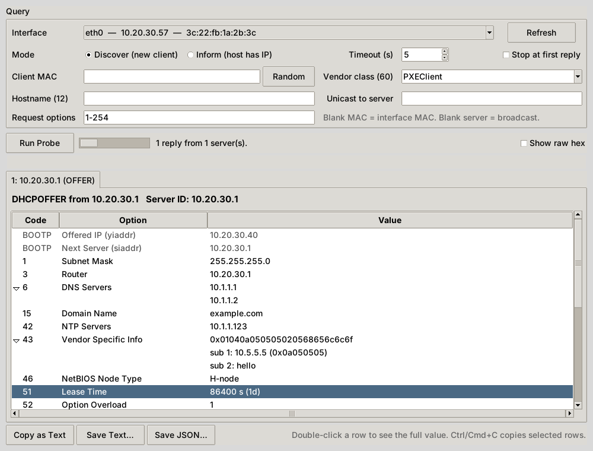

<p align="center">
  
</p>

<h1 align="center">DHCP Options Finder</h1>

<p align="center">
  <b>Ask the DHCP server what it's actually handing out, and decode every option.</b><br>
  Desktop GUI and CLI for Windows, macOS and Linux.
</p>

<p align="center">
  <a href="https://github.com/rbibby53/DHCP_Options_Finder/actions/workflows/ci.yml"></a>
  <a href="https://github.com/rbibby53/DHCP_Options_Finder/releases/latest"></a>
  
  
  <a href="LICENSE"></a>
</p>

<p align="center">
  <a href="https://github.com/rbibby53/DHCP_Options_Finder/releases/latest"><b>⬇ Download</b></a> ·
  <a href="#quick-start">Quick start</a> ·
  <a href="#cli">CLI</a> ·
  <a href="#troubleshooting">Troubleshooting</a>
</p>

<p align="center">
  
</p>

## Why

Checking what a scope delivers usually means a packet capture or logging into the DHCP server. That's slow when you're standing at a controller, phone or AP that won't come up. DHCP Options Finder sends one probe from your laptop and shows the reply as a readable table: router, DNS, NTP, option 43, TFTP/boot settings, classless routes, all of it.

- **Takes no lease.** It sends DISCOVER or INFORM and never REQUEST.
- **Asks for everything.** Requests all 254 option codes, so servers that only return what's requested still show their full config.
- **Sees every server.** Collects every reply in the window and warns when more than one DHCP server answers (possible rogue).
- **Impersonates a device.** Set the client MAC and vendor class (option 60) to see reservation- and class-specific options, e.g. option 43 for a particular AP or controller.
- **Decodes the hard ones:** 43 sub-TLVs, 82 relay info, 119 domain search (with compression), 121/249 classless routes, 125 vendor-identifying info, option overload (52) and RFC 3396 split options. Anything unknown is shown as text or hex.
- **Exports** to text or JSON, or copies selected rows to the clipboard.

## Quick start

### Download

Grab the build for your OS from the **[latest release](https://github.com/rbibby53/DHCP_Options_Finder/releases/latest)**:

| OS | File | Run |
|---|---|---|
| Windows | `DHCPOptionsFinder-windows-x64.exe` | Double-click. If nothing comes back, right-click and choose **Run as administrator** |
| macOS (Apple silicon) | `DHCPOptionsFinder-macos-arm64.zip` | Unzip, then `sudo DHCPOptionsFinder.app/Contents/MacOS/DHCPOptionsFinder` |
| macOS (Intel) | `DHCPOptionsFinder-macos-x64.zip` | Same as above |
| Linux | `DHCPOptionsFinder-linux-x64.tar.gz` | `tar xzf …` then `sudo ./DHCPOptionsFinder` |

CLI-only builds (`dhcpprobe-cli-*`) and `SHA256SUMS.txt` are attached to every release.

> [!NOTE]
> Builds are not code-signed yet. On macOS, if Gatekeeper blocks the app: right-click, then **Open**, or run `xattr -dr com.apple.quarantine DHCPOptionsFinder.app`. On Windows, SmartScreen will warn: click **More info**, then **Run anyway**.

### From source

```bash
git clone https://github.com/rbibby53/DHCP_Options_Finder.git
cd DHCP_Options_Finder
pip install -r requirements.txt
sudo python3 dhcpprobe_gui.py      # Windows: py dhcpprobe_gui.py
```

You need Python 3.9+ with Tkinter (Fedora: `sudo dnf install python3-tkinter`, Debian/Ubuntu: `sudo apt install python3-tk`, Homebrew: `brew install python-tk`).

### Using it

1. Pick the **interface** on the segment you care about. The one with the default route is preselected.
2. Choose a **mode**:
   - **Discover** shows what a brand-new client on this segment would get. Use this most of the time.
   - **Inform** shows the config for a host that already has an IP. No address is offered, but options are.
3. Optionally set a **Client MAC** (a device's real MAC, to see its reservation) and a **Vendor class** (e.g. `PXEClient`, `MSFT 5.0`, your AP's class string).
4. Click **Run Probe**. Each reply gets its own tab. Double-click a row for the full value, and tick **Show raw hex** to see the bytes.

## CLI

The same engine works without the GUI:

```bash
sudo python3 dhcpprobe.py --list                             # interfaces (* = default route)
sudo python3 dhcpprobe.py -i eth0                            # DISCOVER, request all options
sudo python3 dhcpprobe.py -i eth0 -m inform                  # INFORM from the current IP
sudo python3 dhcpprobe.py -i eth0 -V "PXEClient" -x          # send option 60, show raw hex
sudo python3 dhcpprobe.py -i eth0 --mac 3c:22:fb:1a:2b:3c    # options for that MAC's reservation
sudo python3 dhcpprobe.py -i eth0 -s 10.20.30.1              # unicast to one server
sudo python3 dhcpprobe.py -i eth0 -j > options.json          # JSON for scripts
```

<details>
<summary>Example output</summary>

```text
=== Reply 1: DHCPOFFER from 10.20.30.1  (Server ID 10.20.30.1) ===
  Offered IP (yiaddr)                10.20.30.40
  Next Server (siaddr)               10.20.30.1

  Code  Option                             Value
  ----  ---------------------------------- ----------------------------------------
     1  Subnet Mask                        255.255.255.0
     3  Router                             10.20.30.1
     6  DNS Servers                        10.1.1.1
                                           10.1.1.2
    15  Domain Name                        example.com
    42  NTP Servers                        10.1.1.123
    43  Vendor Specific Info               0x01040a050505020568656c6c6f
                                           sub 1: 10.5.5.5 (0x0a050505)
                                           sub 2: hello
    51  Lease Time                         86400 s (1d)
    54  Server Identifier                  10.20.30.1
    66  TFTP Server Name                   tftp.example.com
    67  Bootfile Name                      pxelinux.0
   119  Domain Search List                 bas.example.com
                                           it.example.com
   121  Classless Static Routes            10.50.0.0/24 via 10.20.30.254
                                           0.0.0.0/0 via 10.20.30.1
   150  TFTP Server Address (Cisco)        10.9.9.9
```
</details>

Run `python3 dhcpprobe.py --help` for every flag. The exit code is `0` if at least one server replied and `1` if none did, which makes it usable in monitoring scripts.

## Troubleshooting

| Symptom | Fix |
|---|---|
| `Permission denied on UDP/68` | Run with `sudo` (Linux/macOS) or as Administrator (Windows). DHCP clients must use port 68. |
| `Can't bind UDP/68 … address in use` | Another DHCP client owns the port, often `dhclient` on Linux. NetworkManager's built-in client doesn't conflict. |
| No replies | Check you're on the right interface/VLAN and that the scope or a relay (`ip helper-address`) covers this segment. Try the other mode. |
| Option 43 missing | The server probably keys it on vendor class. Set **Vendor class (60)** to what the device sends. |
| Windows: nothing back in Discover | Try **Inform**. Its reply is unicast to your IP, which is more likely to reach the app on Windows. |

## How it works

DHCP Options Finder builds a standard BOOTP/DHCP packet with option 55 (Parameter Request List) set to codes 1–254. Option 55 is split across instances per RFC 3396, since it doesn't fit in 255 bytes. It's sent from UDP/68 to 255.255.255.255:67 (or a server you name) with the broadcast flag set. The socket is pinned to the selected NIC (`SO_BINDTODEVICE` on Linux, `IP_BOUND_IF` on macOS, bound to the interface address on Windows). Replies are matched on transaction ID and decoded. Nothing beyond that single packet is ever sent.

## Development

```bash
pip install -r requirements.txt pytest ruff
ruff check .
python -m pytest                                           # unit tests
sudo -E DHCPPROBE_LOOPBACK=1 python3 -m pytest tests/test_loopback.py   # real sockets vs a fake server
```

CI runs lint plus unit and loopback tests on Windows, macOS and Linux for Python 3.9 and 3.13. Pushing a `v*` tag builds the apps for all platforms and publishes a GitHub Release.

## License

[AGPL-3.0](LICENSE) © Ryan J. Bibby
