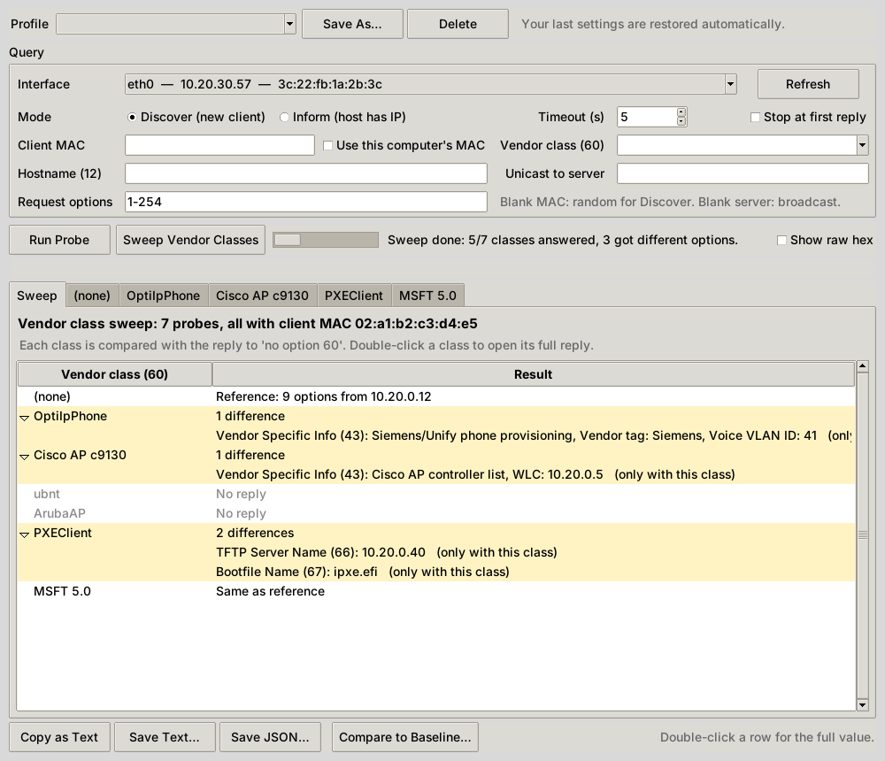
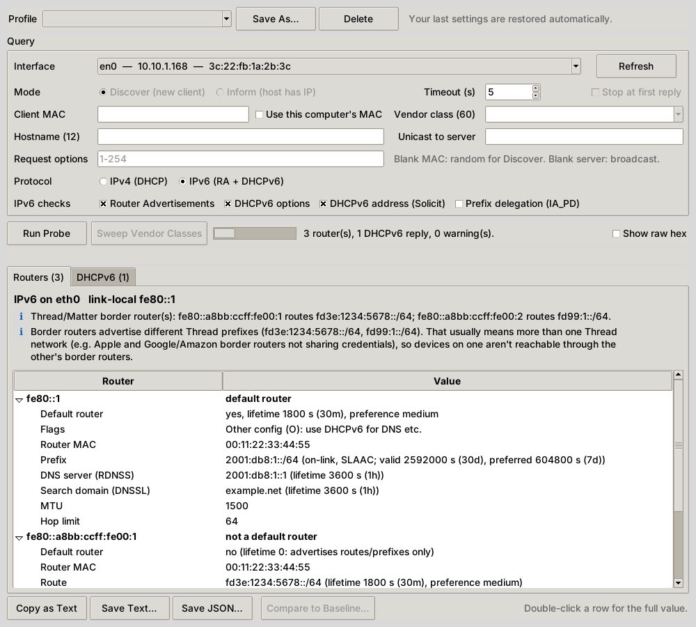

<p align="center">
  
</p>

<h1 align="center">DHCP Options Finder</h1>

<p align="center">
  <b>Ask the DHCP server what it's actually handing out, and decode every option.</b><br>
  Desktop GUI and CLI for Windows, macOS and Linux.
</p>

<p align="center">
  <a href="https://github.com/rbibby53/DHCP_Options_Finder/actions/workflows/ci.yml"></a>
  <a href="https://github.com/rbibby53/DHCP_Options_Finder/releases/latest"></a>
  
  
  <a href="LICENSE"></a>
</p>

<p align="center">
  <a href="https://github.com/rbibby53/DHCP_Options_Finder/releases/latest"><b>⬇ Download</b></a> ·
  <a href="#quick-start">Quick start</a> ·
  <a href="#cli">CLI</a> ·
  <a href="#troubleshooting">Troubleshooting</a>
</p>

<p align="center">
  
</p>

## Why

Checking what a scope delivers usually means a packet capture or logging into the DHCP server. That's slow when you're standing at a controller, phone or AP that won't come up. DHCP Options Finder sends one probe from your laptop and shows the reply as a readable table: router, DNS, NTP, option 43, TFTP/boot settings, classless routes, all of it.

- **Takes no lease.** It sends DISCOVER or INFORM and never REQUEST.
- **Asks for everything.** Requests all 254 option codes, so servers that only return what's requested still show their full config.
- **Sees every server.** Collects every reply in the window and warns when more than one DHCP server answers (possible rogue).
- **Impersonates a device.** Set the client MAC and vendor class (option 60) to see reservation- and class-specific options, e.g. option 43 for a particular AP or controller.
- **Sweeps vendor classes.** One click probes as a Siemens phone, a Cisco AP, UniFi, Aruba, PXE and a Windows client, all with the same MAC, and shows exactly which options each class gets.
- **Knows the vendor formats.** Option 43 is decoded for Siemens/Unify phones (voice VLAN, DLS server), Cisco APs (WLC list), UniFi (controller), Aruba and Microsoft. Anything else falls back to sub-options, text or hex.
- **Checks the config.** Flags likely mistakes: router outside the subnet, mismatched broadcast address, missing DNS or NTP, out-of-order renewal timers, conflicting TFTP servers, leftover WINS.
- **Spots drift.** Save a known-good scope as a baseline; later probes show exactly what changed.
- **Decodes the hard ones:** 82 relay info, 119 domain search (with compression), 121/249 classless routes, 125 vendor-identifying info, option overload (52) and RFC 3396 split options.
- **Does IPv6 too.** Listens for Router Advertisements (prefixes, M/O flags, RDNSS, routes) and runs DHCPv6 Information-Request and Solicit, then checks for rogue RAs, flags with no DHCPv6 server, missing DNS for Android, broken SLAAC prefixes and split Thread/Matter networks.
- **Remembers your setups.** Save named profiles (interface, vendor class, MAC…); the last settings come back on launch.
- **Exports** to text or JSON, or copies selected rows to the clipboard.

## Quick start

### Download

Grab the build for your OS from the **[latest release](https://github.com/rbibby53/DHCP_Options_Finder/releases/latest)**:

| OS | File | Run |
|---|---|---|
| Windows | `DHCPOptionsFinder-windows-x64.exe` | Double-click. If it needs admin rights, it offers to relaunch itself |
| macOS (Apple silicon) | `DHCPOptionsFinder-macos-arm64.zip` | Unzip and open. If it needs admin rights, it asks for your password and relaunches |
| Linux | `DHCPOptionsFinder-linux-x64.tar.gz` | `tar xzf …` then `sudo ./DHCPOptionsFinder` (glibc 2.39+: Fedora 40+, Ubuntu 24.04+, Debian 13, RHEL 10) |

CLI-only builds (`dhcpprobe-cli-*`), a Python wheel and `SHA256SUMS.txt` are attached to every release. Every file also has a signed build-provenance attestation, so you can check it was built by this repo's release workflow:

```bash
gh attestation verify DHCPOptionsFinder-macos-arm64.zip -R rbibby53/DHCP_Options_Finder
```

Intel Macs are no longer supported. The last Intel build is in [v0.1.0](https://github.com/rbibby53/DHCP_Options_Finder/releases/tag/v0.1.0); running [from source](#from-source) still works.

> [!NOTE]
> Once signing is set up ([docs/macos-signing.md](docs/macos-signing.md)), the macOS app is signed with a Developer ID and notarized by Apple, and each release's notes say whether it is. An unsigned Mac build that Gatekeeper blocks can still be opened: right-click it, then **Open**, or run `xattr -dr com.apple.quarantine DHCPOptionsFinder.app`. Windows builds are unsigned, so SmartScreen will warn: click **More info**, then **Run anyway**.

### With pipx

Installs the `dhcpprobe` command and the `dhcp-options-finder` GUI into their own environment:

```bash
pipx install git+https://github.com/rbibby53/DHCP_Options_Finder.git
sudo "$(command -v dhcpprobe)" --list     # sudo doesn't search ~/.local/bin, so pass the full path
sudo -E "$(command -v dhcp-options-finder)"
```

Upgrade with `pipx upgrade dhcp-options-finder`.

### From source

```bash
git clone https://github.com/rbibby53/DHCP_Options_Finder.git
cd DHCP_Options_Finder
pip install -r requirements.txt
sudo python3 dhcpprobe_gui.py      # Windows: py dhcpprobe_gui.py
```

Either way you need Python 3.11+ with Tkinter (Fedora: `sudo dnf install python3-tkinter`, Debian/Ubuntu: `sudo apt install python3-tk`, Homebrew: `brew install python-tk`).

### Using it

1. Pick the **interface** on the segment you care about. The one with the default route is preselected.
2. Choose a **mode**:
   - **Discover** shows what a brand-new client on this segment would get. Use this most of the time.
   - **Inform** shows the config for a host that already has an IP. No address is offered, but options are.
3. Optionally set a **Client MAC** (a device's real MAC, to see its reservation) and a **Vendor class** (e.g. `OptiIpPhone`, `PXEClient`, your AP's class string). With the MAC blank, Discover uses a random MAC so an existing lease on your computer doesn't skew the answer. Tick **Use this computer's MAC** to send yours instead.
4. Click **Run Probe**. Each reply gets its own tab, with config checks at the top. Double-click a row for the full value, and tick **Show raw hex** to see the bytes.
5. To find out which device types get special options, click **Sweep Vendor Classes**. It probes once per preset class, plus any custom class you typed, all with the same MAC. The **Sweep** tab lists what each class gets that the others don't; double-click a class to open its full reply.

   

6. To track changes, **Save JSON…** a known-good result, then later click **Compare to Baseline…** and pick that file. Changed options are highlighted and listed above the table.
7. For **IPv6**, set **Protocol** to *IPv6 (RA + DHCPv6)*, pick which checks to run, and click **Run Probe**. The **Routers** tab lists every router that answered a Router Solicitation, with flags, prefixes, DNS and routes, and the IPv6 checks on top. The **DHCPv6** tab shows each server's reply.

   

8. **Profile → Save As…** stores the current settings under a name, e.g. "Siemens phone" or "AP VLAN". Your last settings are also restored automatically. Profiles live in your user folder (`%APPDATA%`, `~/Library/Application Support` or `~/.config`), even when the app runs as administrator.

## CLI

The same engine works without the GUI:

```bash
sudo python3 dhcpprobe.py --list                             # interfaces (* = default route)
sudo python3 dhcpprobe.py -i eth0                            # DISCOVER, request all options
sudo python3 dhcpprobe.py -i eth0 -m inform                  # INFORM from the current IP
sudo python3 dhcpprobe.py -i eth0 -V "PXEClient" -x          # send option 60, show raw hex
sudo python3 dhcpprobe.py -i eth0 -V OptiIpPhone             # what a Siemens/Unify phone gets
sudo python3 dhcpprobe.py -i eth0 --mac 3c:22:fb:1a:2b:3c    # options for that MAC's reservation
sudo python3 dhcpprobe.py -i eth0 --mac iface                # use this computer's MAC (default: random)
sudo python3 dhcpprobe.py -i eth0 -s 10.20.30.1              # unicast to one server
sudo python3 dhcpprobe.py -i eth0 -j > options.json          # JSON for scripts (includes checks)
sudo python3 dhcpprobe.py -i eth0 --save-baseline bas.json   # record a known-good scope
sudo python3 dhcpprobe.py -i eth0 --baseline bas.json        # compare; exit 3 if anything changed
sudo python3 dhcpprobe.py -i eth0 --sweep                    # which options each vendor class gets
sudo python3 dhcpprobe.py -i eth0 --sweep-classes ",OptiIpPhone,Mitel"  # sweep your own list ('' = none)
sudo python3 dhcpprobe.py -i eth1 -V OptiIpPhone --save-profile phones  # remember these settings
sudo python3 dhcpprobe.py -p phones                          # reuse them (flags still override)
sudo python3 dhcpprobe.py --list-profiles
sudo python3 dhcpprobe.py -i eth0 -6                         # IPv6: Router Advertisements + DHCPv6
sudo python3 dhcpprobe.py -i eth0 -6 --no-solicit            # IPv6 options only, don't ask for an address
sudo python3 dhcpprobe.py -i eth0 -6 --pd -j                 # also ask for a delegated prefix; JSON
```

<details>
<summary>Example output</summary>

```text
=== Reply 1: DHCPOFFER from 10.20.30.1  (Server ID 10.20.0.12) ===
  Offered IP (yiaddr)                10.20.30.142
  Relay Agent (giaddr)               10.20.30.1

  Code  Option                             Value
  ----  ---------------------------------- ----------------------------------------
     1  Subnet Mask                        255.255.255.0
     3  Router                             10.20.30.1
     6  DNS Servers                        10.20.0.5
                                           10.20.0.10
    15  Domain Name                        example.edu
    28  Broadcast Address                  10.20.30.255
    43  Vendor Specific Info               Siemens/Unify phone provisioning
                                           Vendor tag: Siemens
                                           Voice VLAN ID: 41
                                           raw: 0x01075369656d656e73020400000029
    44  NetBIOS Name Servers (WINS)        10.20.0.30
    51  Lease Time                         691200 s (8d)
    53  Message Type                       OFFER
    54  Server Identifier                  10.20.0.12

  Checks:
    i No NTP servers (42). Devices that take time from DHCP (many BAS controllers, IP phones) won't sync, which skews trend and alarm timestamps.
    i WINS/NetBIOS options (44/46) are set. These are legacy; remove them if nothing on this segment still uses WINS.

  Changes vs baseline:
    ~   6 DNS Servers: 10.20.0.5, 10.20.0.11 -> 10.20.0.5, 10.20.0.10
```
</details>

<details>
<summary>Example IPv6 probe</summary>

```text
IPv6 on en0 (link-local fe80::1c2b:3cff:fe4d:5e6f)

=== Router Advertisements: 2 router(s) ===

  Router fe80::1
    Default router           yes, lifetime 1800 s (30m), preference medium
    Flags                    Other config (O): use DHCPv6 for DNS etc.
    Router MAC               00:11:22:33:44:55
    Prefix                   2001:db8:1::/64 (on-link, SLAAC; valid 2592000 s (30d), preferred 604800 s (7d))
    DNS server (RDNSS)       2001:db8:1::1 (lifetime 3600 s (1h))
    Search domain (DNSSL)    example.net (lifetime 3600 s (1h))
    MTU                      1500
    Hop limit                64

  Router fe80::a8bb:ccff:fe00:1
    Default router           no (lifetime 0: advertises routes/prefixes only)
    Router MAC               00:11:22:33:44:55
    Route                    fd3e:1234:5678::/64 (lifetime 1800 s (30m), preference medium)
    Hop limit                64

=== DHCPv6: 1 reply ===

  REPLY to information-request from fe80::53
  Code  Option                         Value
  ----  ------------------------------ ------------------------------------
     1  Client Identifier              DUID-LL 02:aa:bb:cc:dd:ee
     2  Server Identifier              DUID-LL 00:11:22:33:44:55
    23  DNS Servers                    2001:db8:1::53
                                       2001:db8:1::54
    24  Domain Search List             example.net
    56  NTP Servers                    server 2001:db8:1::123
                                       server time.example.net
    32  Information Refresh Time       86400 s (1d)

Checks:
  i Thread/Matter border router(s): fe80::a8bb:ccff:fe00:1 routes fd3e:1234:5678::/64.
```
</details>

<details>
<summary>Example sweep</summary>

```text
Vendor class sweep: 7 probes, client MAC 02:a1:b2:c3:d4:e5 for every probe

  (none)          reference: 8 options from 10.20.0.12
  OptiIpPhone     +  43 Vendor Specific Info: Siemens/Unify phone provisioning, Vendor tag: Siemens, Voice VLAN ID: 41  (only this class)
  Cisco AP c9130  +  43 Vendor Specific Info: Cisco AP controller list, WLC: 10.20.0.5  (only this class)
  ubnt            no reply
  ArubaAP         no reply
  PXEClient       +  66 TFTP Server Name: 10.20.0.40  (only this class)
                  +  67 Bootfile Name: ipxe.efi  (only this class)
  MSFT 5.0        same as reference
```
</details>

Run `python3 dhcpprobe.py --help` for every flag. Exit codes: `0` a server replied, `1` no replies, `3` the reply differs from `--baseline`. That makes it usable from a scheduled job or monitoring system to catch scope changes.

Baseline comparison works on the raw option bytes and ignores options that legitimately vary between probes: the requested IP (50), message type (53), server identifier (54, so failover partners don't count as drift), client ID (61) and relay agent info (82).

## Troubleshooting

| Symptom | Fix |
|---|---|
| `Permission denied on UDP/68` | DHCP clients must use port 68. On Windows and macOS the app offers to relaunch with admin rights; on Linux run it with `sudo -E`. |
| `Can't bind UDP/68 … address in use` | Another DHCP client owns the port, often `dhclient` on Linux. NetworkManager's built-in client doesn't conflict. |
| No replies | Check you're on the right interface/VLAN and that the scope or a relay (`ip helper-address`) covers this segment. Try the other mode. |
| Option 43 missing | The server probably keys it on vendor class. Set **Vendor class (60)** to what the device sends. |
| Windows: nothing back in Discover | Try **Inform**. Its reply is unicast to your IP, which is more likely to reach the app on Windows. |
| IPv6: `no IPv6 link-local address` | IPv6 is disabled on that interface. |
| IPv6: no Router Advertisements | IPv6 isn't routed on this segment, or RA Guard on the switch port is dropping them. Routers answer a Router Solicitation right away, so a longer timeout rarely helps. |
| IPv6 on Windows: router details look thinner | Windows never hands Router Advertisements to applications. On Windows the app sends the Router Solicitation, then shows what Windows learned: default routers, Thread/RIO routes, SLAAC prefixes, M/O flags and DNS servers. Raw RA fields such as MTU, RDNSS vs DHCPv6 source, DNSSL and router preference aren't available. |

## How it works

DHCP Options Finder builds a standard BOOTP/DHCP packet with option 55 (Parameter Request List) set to codes 1–254. Option 55 is split across instances per RFC 3396, since it doesn't fit in 255 bytes. It's sent from UDP/68 to 255.255.255.255:67 (or a server you name) with the broadcast flag set. The socket is pinned to the selected NIC (`SO_BINDTODEVICE` on Linux, `IP_BOUND_IF` on macOS, bound to the interface address on Windows). Replies are matched on transaction ID and decoded. Nothing beyond that single packet is ever sent.

For IPv6 it sends one Router Solicitation to `ff02::2` from a raw ICMPv6 socket and collects Router Advertisements. At the same time it sends a DHCPv6 Information-Request and a Solicit (without Rapid Commit) from UDP/546 to `ff02::1:2`. It never sends a Request, so no IPv6 lease is taken either.

## Development

```bash
pip install -r requirements-dev.txt
ruff check .
python -m pytest                                           # unit tests
sudo -E DHCPPROBE_LOOPBACK=1 python3 -m pytest tests/test_loopback.py   # real sockets vs a fake server
```

CI runs lint plus unit and loopback tests on Windows, macOS and Linux against Python 3.11 (oldest supported) and 3.15 (latest). Release builds use Python 3.15.

Code layout (`dhcp_options_finder/`):

| Module | Does |
|---|---|
| `options.py` | Option table, decoders, vendor option 43 layouts, vendor class presets |
| `packet.py` | Build requests, parse replies (overload, RFC 3396) |
| `net.py` | Interfaces, per-OS sockets, `probe()` and `sweep()` |
| `checks.py` | Config checks |
| `baseline.py` | Baseline load and compare |
| `report.py` | Summaries, text/JSON output, sweep reports |
| `profiles.py` | Saved profiles and last-used settings |
| `cli.py`, `gui.py` | The two front ends |

### Releasing

1. In a PR, bump the version in `pyproject.toml` and `__version__` in `dhcpprobe.py`, and move the `[Unreleased]` notes in `CHANGELOG.md` under a new `## [X.Y.Z] - date` heading.
2. Merge it. The **Release** workflow sees that `vX.Y.Z` doesn't exist yet, builds every platform, creates the tag, and publishes the GitHub Release using the changelog section as release notes.

Merges that don't change the version don't release anything. Running **Release** by hand from the Actions tab builds the apps as downloadable artifacts without publishing.

## License

[AGPL-3.0](LICENSE) © Ryan J. Bibby
